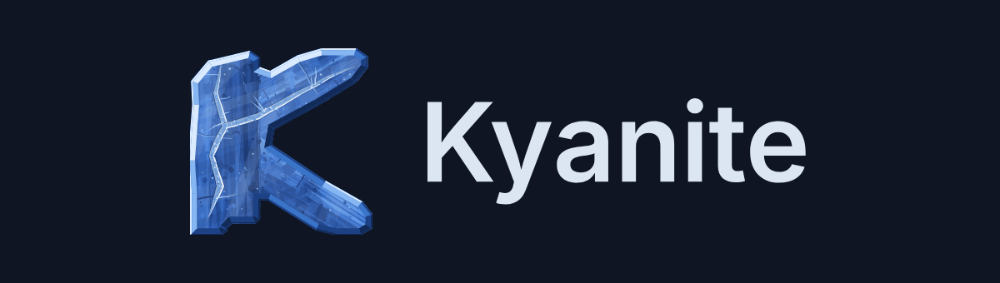

# The Kyanite logo

A K cut from a block of kyanite, crossed by a vein of resin that seals
its fracture. It comes on two grounds: one for dark backgrounds, one for
light.

<picture>
  <source media="(prefers-color-scheme: dark)" srcset="png/banner.png">
  <source media="(prefers-color-scheme: light)" srcset="png/banner-light.png">
  
</picture>

## The files

Files with no suffix are for **dark** backgrounds; the `-light` ones are
for **light** backgrounds. Same geometry, same light from the top left —
only the values differ.

| file | what for |
|---|---|
| `kyanite-logo.svg` · `kyanite-logo-light.svg` | The full drawing. Website, installer banner, anything shown **at 64 px or more**. |
| `kyanite-icon.svg` · `kyanite-icon-light.svg` | The simplified version, for **under 64 px**: system icon, favicon, taskbar. |
| `kyanite-logotype.svg` · `kyanite-logotype-light.svg` | The symbol followed by the word "Kyanite". |
| `png/kyanite-<size>.png` · `png/kyanite-<size>-light.png` | 16, 22, 24, 32, 48, 64, 128, 256, 512 px, transparent background. |
| `png/banner.png` · `png/banner-light.png` | The logotype **with its background**, for a README or a page whose theme you do not control. |

PNGs under 128 px are rendered from the icon, the rest from the full
logo. The switch is at 128 and no lower: at 64 and 96 px the grain and
the spangles of the full drawing are nothing but noise and the seam
bleeds — the result there would be less legible than the icon at 48 px.

To rebuild everything: `sh ../tools/build.sh`.

**The delivered files are already optimised** — there is no need to run
them through a compressor again. The SVGs went through svgo, the PNGs
through pngquant then oxipng: 591 kB → 206 kB for the whole set, with no
visible difference (worst case 1.07 out of 255, root mean square).

## Which ground

This is the one choice you have to get right, and it is not a matter of
taste — on the wrong ground the mark loses its outline.

**Use the dark files on a dark background**, between about `#0A0E18` and
`#1E2534`. Reference: `#0F1522`.

**Use the light files on a light background**, from `#FFFFFF` down to
about `#E6E9ED` — GitHub in light theme, Breeze Light (`#EFF0F1`), a
white page, a printed sheet. Reference: `#FFFFFF`.

Why it matters, measured on the rendered pixels rather than assumed. The
drawing is lit from the top left, and on a dark ground the keenest facet
blows out to near-white (`#DBEBFF`). Against white that edge is 1.21:1 —
invisible. Put the dark files on a white page and **about 40% of the
contour falls below 3:1**; the top-left edges dissolve and the shape
opens up.

The light palette pushes the whole value scale below the page instead:
deep navy in shadow, mid blue in the light. On white, **none** of its
contour falls below 3:1 (lowest 3.47:1, median 7.5:1). On Breeze Light
the keen edge still holds at 3.04:1.

The asymmetry is worth knowing. On a dark ground the contour is carried
by the bright lit edge, and the deepest facet is *meant* to sink into the
background. On a light ground it is the mass itself that carries the
contour, and the lit edge is simply the palest part of the stone — never
paler than the page. That is why neither variant survives on the other's
ground, and why there are two.

If you genuinely cannot know the background, use `png/banner.png` or
`png/banner-light.png`, which carry their own. In HTML and in a GitHub
README you can serve both and let the reader's theme choose:

```html
<picture>
  <source media="(prefers-color-scheme: dark)" srcset="png/banner.png">
  <source media="(prefers-color-scheme: light)" srcset="png/banner-light.png">
  
</picture>
```

## Palette

If you only need a few values:

| role | dark ground | light ground |
|---|---|---|
| reference background | `#0F1522` | `#FFFFFF` |
| kyanite blue, core | `#3668C1` | `#214887` |
| kyanite blue, pale | `#5793E4` | `#3A6DBE` |
| lit edge | `#DBEBFF` | `#4E8BDC` |
| hollow, shadow | `#112A58` | `#07122A` |
| the word, in the logotype | `#DCE6F2` | `#16253D` |

The full palette:

| series | dark ground | light ground |
|---|---|---|
| the rock, 9 values | `#15306A` `#1B3B7C` `#21468E` `#2851A0` `#2E5CB1` `#3668C1` `#3F75CE` `#4A83DA` `#5793E4` | `#0B1C40` `#0F244E` `#132C5C` `#17356A` `#1C3E79` `#214887` `#285496` `#2F60A5` `#3A6DBE` |
| the bevel, 5 values | `#112A58` `#1C4184` `#3A74C8` `#86B7F2` `#DBEBFF` | `#07122A` `#0F2350` `#23508F` `#3A74C8` `#4E8BDC` |
| the filled seam | stone lip `#12305F` · resin `#9CC6F4` · core `#7FB3EE` · meniscus `#F2F8FF` · sheen `#C6DFFA` | stone lip `#091B3C` · resin `#7FAEE4` · core `#5E90D4` · meniscus `#DCE9FA` · sheen `#9CC0EC` |
| bubbles in the resin | `#F7FBFF` `#285AA6` | `#EAF2FD` `#16305E` |
| spangles | `#C6DEFA` `#A8CCF4` `#88B8F0` `#6AA0E8` `#4D86DA` | `#A8C8F0` `#8BB0E6` `#6E98DC` `#5480CE` `#3F6CC0` |
| quartz, mica | `#86B6EE` `#A8CCF4` · `#1C3C76` `#22477F` | `#5E90D8` `#7BA8E4` · `#0A1835` `#0E1E42` |
| fractures | `#1E4588` `#6CA2E8` | `#0D2048` `#3E72C4` |
| planes passing through | pale `#BBD8F8` · dark `#0C2149` | pale `#A9C8EC` · dark `#06102A` |

The icon flattens its tints — at 16 px, stacking opacities only gives
mush:

| role | dark ground | light ground |
|---|---|---|
| stem, lit · shadow | `#3A74CA` · `#234C92` | `#255494` · `#122C57` |
| upper arm, lit · shadow | `#74ABEE` · `#4280D6` | `#4E8BDC` · `#2A5FA8` |
| lower arm, lit · shadow | `#4D8ADA` · `#2E60B4` | `#336FC0` · `#1C4480` |
| seam: stone lip · body · meniscus | `#163A74` · `#7CA6E0` · `#EAF4FF` | `#0E2448` · `#5E8ECE` · `#CFE2F8` |

## How to use it

**Clear space.** Leave at least **a quarter of its height** around the
symbol, free of text, rules and edges. The SVGs already carry about 10%
internal margin: that does not count towards the quarter.

**Minimum sizes.** 16 px for the icon. 120 px wide for the logotype —
below that the word goes illegible well before the symbol does.

**Switch.** Under 64 px, use `kyanite-icon.svg`. Above, `kyanite-logo.svg`.

## What not to do

- **Do not put a variant on the wrong ground.** This is the one that
  actually breaks the mark; see [Which ground](#which-ground) above.
- **Do not recolour it.** The light comes from the top left and the
  values are computed from the orientation of each facet. Changing the
  hue breaks that coherence. If you need another ground, ask rather than
  improvise — the two palettes here were built by moving the whole value
  scale, not by tinting.
- **Do not rotate or mirror it.** Same reason: the light would come from
  somewhere else.
- **Do not stretch it.** The proportions are set for the square.
- **Do not add a drop shadow, a glow, an outline or a relief.** The
  relief is already in the drawing.
- **Do not crop it** into a circle or a rounded square: the foot and the
  blade edges would be cut. Place it inside the shape, with its margin.
- **Do not use the symbol as a letter** in a word or a title.
- **Do not redraw the word** in another typeface: use
  `kyanite-logotype.svg`.

## Name and logo

Kyanite's code is free software. **The name "Kyanite" and this logo are
not**: they identify the project and stay reserved for its use.

You may reproduce them to talk about Kyanite — an article, a talk, a page
of links, a package repository. You may not use them to name or sign a
derived image, a product or a service, nor to suggest that the project
endorses you. Rebuild an image from the code as much as you like, but
give it its own name and its own mark.

The full terms are in [`LICENSE`](../LICENSE). For anything outside them,
ask.

## Two technical points

The word in the logotype is set in **Inter SemiBold and converted to
outlines**: no font is required to display it. Inter is under the SIL
Open Font License, which explicitly permits derivative works.

The six SVGs use **polygons only**: no filter, no bitmap, no gradient.
The only SVG features used beyond shapes are `clipPath` and
`fill-opacity`, both universal. That is deliberate: a `feTurbulence` or a
gradient renders badly, or not at all, in icon themes and automatic
conversions.

The logo deliberately resembles neither Fedora's "f" nor KDE's gear,
which are registered trademarks.
